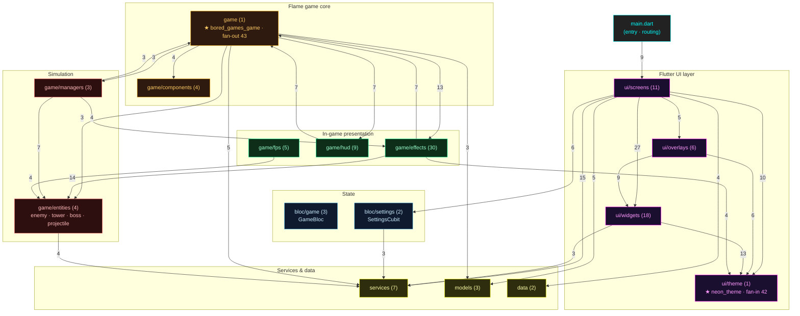

# Dependency Graph — Neon Defense (`flutter_app/lib`)

> **Auto-generated ground truth.** This document is built from a static import analysis of every
> `.dart` file under `flutter_app/lib`. Regenerate it any time with:
>
> ```bash
> cd flutter_app && node scripts/codegraph.js
> ```
>
> The script writes machine-readable data to `flutter_app/scripts/.codegraph/graph.json` (full
> node/edge list, metrics, cycles) and prints a summary. This page is the human-readable view used
> to plan the **Unreal Engine migration**.

## 1. Metrics at a glance

| Metric | Value |
|---|---|
| Dart source files (`lib/`) | **115** |
| Internal import edges | **299** |
| Modules (directories) | **21** |
| Import cycles (SCC > 1) | **2** |
| External packages used | **9** |

### Files per module

| Files | Module | Migration area |
|---:|---|---|
| 30 | `src/game/effects` (incl. `effects/shaders`) | Niagara / Materials / post-process |
| 18 | `src/ui/widgets` | UMG reusable widget library |
| 11 | `src/ui/screens` | UMG screens + UI flow |
| 9 | `src/game/hud` | UMG in-game HUD |
| 7 | `src/services` | `UGameInstanceSubsystem` / SaveGame / audio |
| 6 | `src/ui/overlays` | UMG modal overlays |
| 5 | `src/game/fps` | **Redesign → native 3D** |
| 4 | `src/game/components` | On-grid `AActor`s |
| 4 | `src/game/entities` | Gameplay `AActor`s (+ GAS) |
| 3 | `src/bloc/game` | `AGameStateBase` / GAS attributes |
| 3 | `src/game/managers` | Spawner / pool subsystems |
| 3 | `src/models` | `UDataAsset` / `USTRUCT` |
| 2 | `src/bloc/settings` | SaveGame / settings subsystem |
| 2 | `src/data` | DataTables (story/lore) |
| 2 | `src/game/utils` | C++ helper libs |
| 1 | `main.dart` | `UGameInstance` / startup map |
| 1 | `src/game` (`bored_games_game.dart`) | `AGameModeBase` + root orchestration |
| 1 | `src/game/balance` | Curve `UDataAsset` |
| 1 | `src/game/world` | Level / nav data |
| 1 | `src/ui/theme` | UMG style + master materials |
| 1 | `src/ui/transitions` | UMG animations / sequencer |

## 2. Module dependency diagram (layered)

Edges shown have weight ≥ 3 (number of file-level imports). The full 73-edge matrix is in §5.
Note the **back-edges into `game`** (`effects → game`, `hud → game`, `managers → game`) — these are the
Flame `HasGameRef` cycle (see §4).



## 3. Coupling hubs (where to be careful when migrating)

### Most depended-upon (fan-in) — touching these ripples everywhere

| Fan-in | File | Migration implication |
|---:|---|---|
| 42 | `src/ui/theme/neon_theme.dart` | Central design tokens → one UMG style set + master materials. Port first; everything UI references it. |
| 24 | `src/game/bored_games_game.dart` | The orchestration hub → `AGameModeBase`. Migrate its interface early so entities have a target to bind to. |
| 23 | `src/game/entities/enemy.dart` | Core combat type → base `AEnemy` actor. High reuse value. |
| 12 | `src/game/entities/tower.dart` | → base `ATower` actor. |
| 12 | `src/services/audio_service.dart` | → audio subsystem (MetaSounds). |
| 8 | `src/services/level_service.dart` | → level/loadout subsystem + DataAssets. |
| 7 | `src/models/level_config.dart` | → `USTRUCT`/`UDataAsset`. Pure data, easy port. |

### Most dependencies (fan-out) — the orchestrators / "god" files

| Fan-out | File | Migration implication |
|---:|---|---|
| 43 | `src/game/bored_games_game.dart` | **God object.** Decompose during migration — split orchestration into GameMode + subsystems rather than porting 1:1. |
| 14 | `src/ui/screens/game_screen.dart` | Hosts the game + overlays → main gameplay level/HUD wiring. |
| 13 | `main.dart` | App bootstrap + routing → `UGameInstance` + startup flow. |
| 12 | `src/game/managers/tower_manager.dart` | Placement/upgrade orchestration → placement subsystem. |
| 10 | `src/game/managers/enemy_manager.dart` | Wave spawning → spawner subsystem. |

## 4. Import cycles (critical migration intel)

The analyzer found **2 strongly-connected components**:

### 4.1 — The 37-node Flame core cycle ⚠️

A single SCC links almost the entire `src/game/*` tree plus `services/audio_service` and
`services/level_service`:

```
bored_games_game ⇄ entities/{enemy,tower,boss,projectile}
                 ⇄ managers/{enemy,tower,bullet}
                 ⇄ effects/* (incl. shaders/*)
                 ⇄ hud/*
                 ⇄ fps/*
                 ⇄ components/{neon_mine,neon_pulse}
                 ⇄ services/{audio,level}
```

**Why it exists:** this is the textbook Flame pattern — every `Component` reaches the root game via
`HasGameRef<BoredGamesGame>` / `game.<something>`, and the root holds references back to its children.
Bidirectional references = one giant cycle.

**Migration implication:** you **cannot** port these files one-at-a-time in dependency order — there is
no clean order. Instead:
- Stand up the Unreal skeleton first: `AGameModeBase` + an interface (or a `UWorldSubsystem`) that the
  equivalent of `HasGameRef` resolves to.
- In Unreal, replace `game.x` back-references with `UWorld`/`GameMode`/subsystem lookups
  (`GetWorld()`, `GetGameMode()`, `GetSubsystem`), or with `GameplayMessageSubsystem` events. This
  **breaks the cycle by design** — actors no longer hold hard back-pointers to a god object.
- Treat the whole SCC as **one migration milestone** ("the battle simulation") rather than many.

### 4.2 — UI 2-node cycle

```
ui/screens/level_select_screen.dart ⇄ ui/widgets/universe_graph_widget.dart
```

Minor: a screen and the custom widget it hosts reference each other. Resolve with a delegate/event
binding (UMG: bind via dynamic delegate, not mutual hard refs) when porting.

## 5. External package dependencies → Unreal targets

These are the runtime dependencies that must be *replaced* by engine-native systems.

| Files using | Package | What it provides | Unreal replacement |
|---:|---|---|---|
| 94 | `flutter` | Widgets, painting, material | **UMG / Slate** (UI) + native rendering |
| 56 | `flame` | 2D game loop, component tree, sprites | **Engine core**: Actors, components, Tick, `UStaticMesh`/`UPaperSprite` |
| 7 | `flutter_bloc` | Bloc/Cubit state management | `AGameStateBase` + GAS attributes / a state `UGameInstanceSubsystem` |
| 3 | `equatable` | Value equality | C++ `operator==` / `USTRUCT` comparison |
| 3 | `audioplayers` | Audio playback | **MetaSounds / `UAudioComponent`** |
| 2 | `path_provider` | Filesystem paths | `FPaths` / SaveGame slots |
| 1 | `flame_tiled` | TMX tilemap loading | Imported levels / `UDataAsset` grid or a tile actor |
| 1 | `flame_audio` | Flame audio bridge | MetaSounds |
| 1 | `shared_preferences` | Key-value persistence | `USaveGame` |

**Takeaway:** ~96% of files touch `flutter` or `flame`. The migration is fundamentally an
**engine-substitution**, not a port of incidental libraries.

## 6. Full module-edge matrix (73 edges)

`from → to (weight = number of file-level imports)`. Intra-module edges are omitted.

| w | from → to | | w | from → to |
|---:|---|---|---:|---|
| 27 | `ui/screens → ui/widgets` | | 2 | `data → ui/theme` |
| 15 | `ui/screens → services` | | 2 | `game → game/fps` |
| 14 | `game/effects → game/entities` | | 2 | `game/components → game/entities` |
| 13 | `game → game/effects` | | 2 | `game/effects → services` |
| 13 | `ui/widgets → ui/theme` | | 2 | `game/entities → game` |
| 10 | `ui/screens → ui/theme` | | 2 | `game/entities → game/effects` |
| 9 | `main.dart → ui/screens` | | 2 | `game/entities → game/managers` |
| 9 | `ui/overlays → ui/widgets` | | 2 | `game/fps → game` |
| 7 | `game → game/hud` | | 2 | `game/hud → game/entities` |
| 7 | `game/effects → game` | | 2 | `game/hud → services` |
| 7 | `game/hud → game` | | 2 | `game/managers → game/world` |
| 7 | `game/managers → game/entities` | | 2 | `game/managers → services` |
| 6 | `ui/overlays → ui/theme` | | 2 | `game/managers → models` |
| 6 | `ui/screens → bloc/settings` | | 2 | `game/managers → game/utils` |
| 5 | `game → services` | | 2 | `services → game/entities` |
| 5 | `ui/screens → models` | | 2 | `services → models` |
| 5 | `ui/screens → ui/overlays` | | 2 | `ui/overlays → data` |
| 4 | `game → game/components` | | 2 | `ui/screens → game` |
| 4 | `game/effects → ui/theme` | | 2 | `ui/widgets → ui/screens` |
| 4 | `game/entities → services` | | 1 | `main.dart → bloc/settings` |
| 4 | `game/fps → game/entities` | | 1 | `main.dart → ui/theme` |
| 4 | `game/managers → game/effects` | | 1 | `main.dart → ui/transitions` |
| 4 | `ui/screens → data` | | 1 | `main.dart → ui/widgets` |
| 3 | `bloc/settings → services` | | 1 | `game → game/world` |
| 3 | `game → game/entities` | | 1 | `game → game/balance` |
| 3 | `game → game/managers` | | 1 | `game → ui/theme` |
| 3 | `game → models` | | 1 | `game/components → game/effects` |
| 3 | `game/managers → game` | | 1 | `game/components → ui/theme` |
| 3 | `ui/widgets → services` | | 1 | `game/effects → models` |
| | | | 1 | `game/effects → game/managers` |
| | | | 1 | `game/entities → ui/theme` |
| | | | 1 | `game/entities → models` |
| | | | 1 | `game/hud → data` |
| | | | 1 | `game/hud → game/managers` |
| | | | 1 | `game/hud → ui/theme` |
| | | | 1 | `game/managers → game/balance` |
| | | | 1 | `game/managers → ui/theme` |
| | | | 1 | `ui/overlays → game` |
| | | | 1 | `ui/overlays → models` |
| | | | 1 | `ui/screens → game/entities` |
| | | | 1 | `ui/transitions → ui/widgets` |
| | | | 1 | `ui/transitions → ui/theme` |
| | | | 1 | `ui/widgets → models` |
| | | | 1 | `ui/widgets → data` |

---

*Generated by `flutter_app/scripts/codegraph.js`. See `ARCHITECTURE_MAP.md` for the subsystem-level
map and `FLAME_TO_UNREAL.md` for the construct-by-construct migration matrix.*
